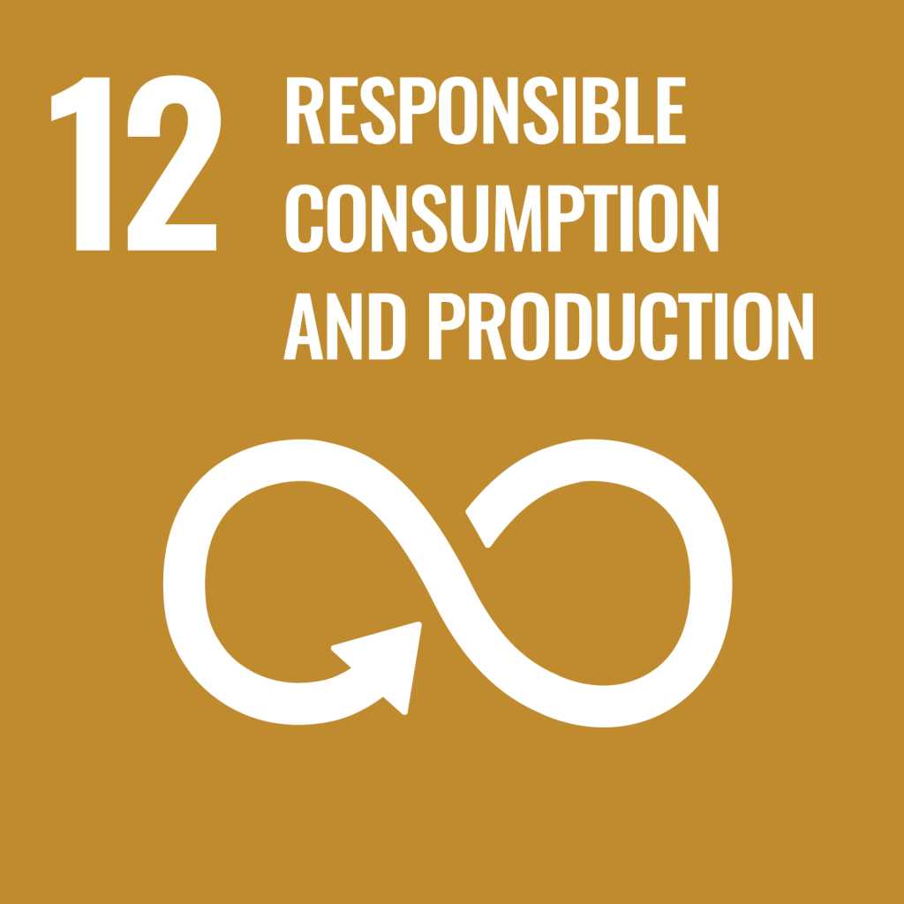
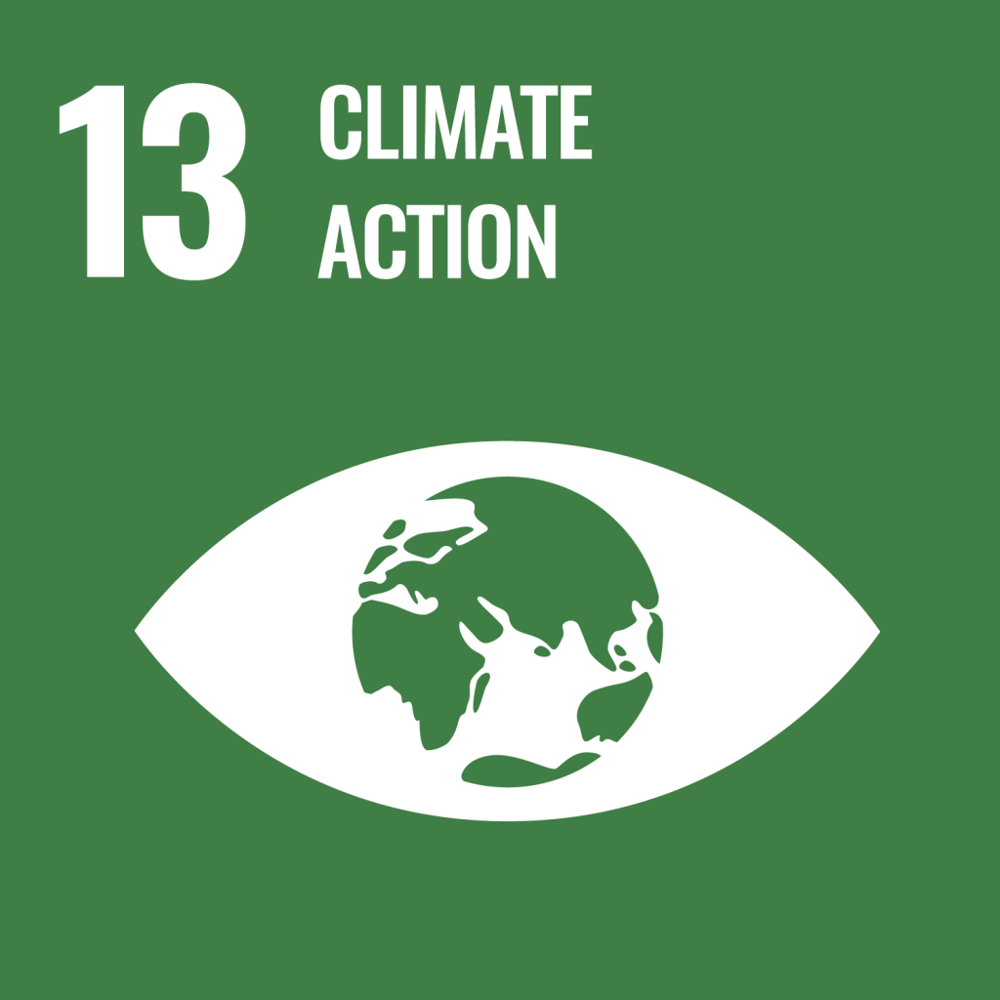
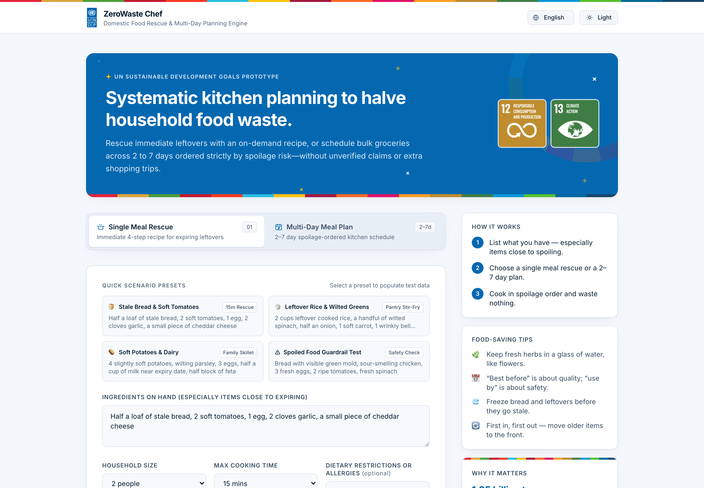
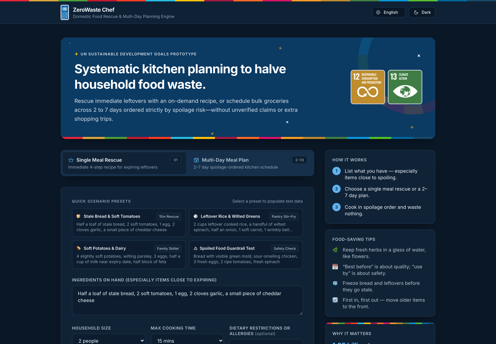
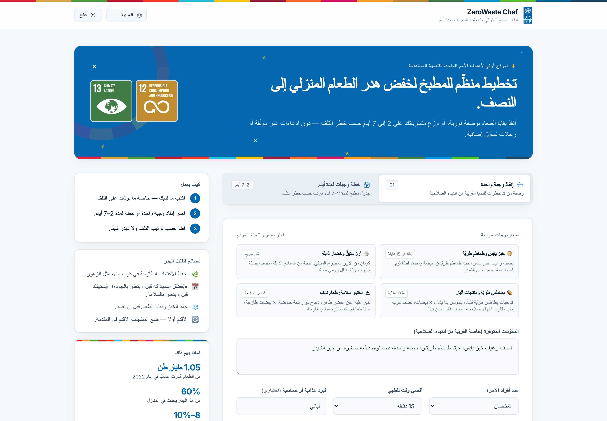
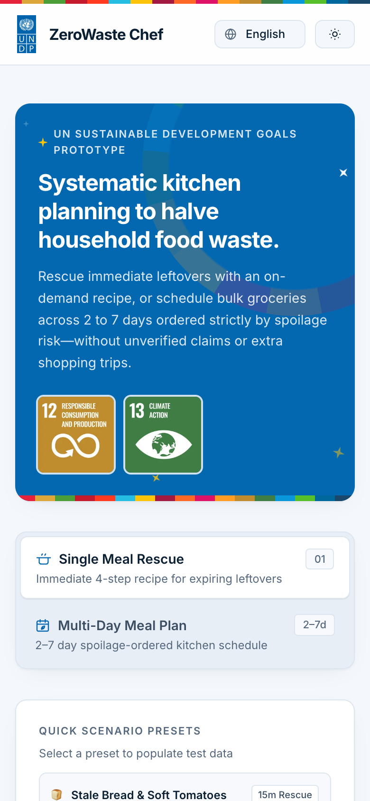
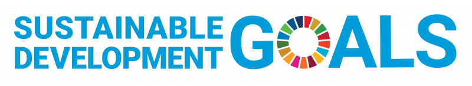

<div align="center">


# ZeroWaste Chef

**Cook what you have. Waste nothing.**

An AI kitchen planner that turns leftovers into recipes and plans meals by spoilage risk,<br />
helping households halve their food waste.

<br />


&nbsp;


<br /><br />


<br />



</div>

---

## Why

Households throw away about **60%** of all wasted food, and food loss and waste causes **8–10%** of global greenhouse gas emissions *(UNEP Food Waste Index Report 2024)*.

ZeroWaste Chef supports **SDG Target 12.3**, which aims to halve per-capita household food waste, and **SDG 13 (Climate Action)**. It turns what is already in your kitchen into a clear, safe plan to cook it.

## Features

| | |
|---|---|
| 🍳 **Single Meal Rescue** | Turns expiring leftovers into a quick 4-step recipe, plus a backup idea. |
| 🗓️ **Multi-Day Meal Plan** | Spreads your groceries over 2–7 days. Fragile produce goes first, hardy staples last. |
| 🛡️ **Food Safety Guardrails** | Flags moldy or spoiled items and tells you to discard them safely. |
| 🥗 **Diet-Aware** | Respects allergies and dietary restrictions, and never asks for exotic extra groceries. |
| 🌍 **Seven Languages** | The six official UN languages plus Turkish, with full right-to-left support for Arabic. |
| ♿ **Accessible by Design** | WCAG AA contrast, keyboard navigation, reduced-motion support and screen-reader labels. |
| 🌗 **Light & Dark** | Follows the device theme, with a one-click toggle. |

## Screenshots

<table>
  <tr>
    <td width="50%" align="center">
      
      <br /><sub><b>Dark mode</b></sub>
    </td>
    <td width="50%" align="center">
      
      <br /><sub><b>Arabic · right-to-left</b></sub>
    </td>
  </tr>
  <tr>
    <td colspan="2" align="center">
      
      <br /><sub><b>Mobile</b></sub>
    </td>
  </tr>
</table>

## Languages

| العربية | 中文 | English | Français | Русский | Español | Türkçe |
|:---:|:---:|:---:|:---:|:---:|:---:|:---:|
| Arabic · RTL | Chinese | English | French | Russian | Spanish | Turkish |

The app opens in the visitor's browser language when it is supported, and falls back to English otherwise.

> **Note:** Both the user interface and AI-generated recipes, spoilage rationales, and food-safety/allergen alerts are fully localized across all 7 supported languages.

## Getting Started

**Requirements:** Node.js 18.18+ and a [Google Gemini API key](https://aistudio.google.com/app/apikey).

```bash
# 1. Install dependencies
npm install

# 2. Add your API key
cp .env.example .env.local
#    then set GEMINI_API_KEY in .env.local

# 3. Start the dev server
npm run dev
```

Open **http://localhost:3000**.

| Command | Description |
|---|---|
| `npm run dev` | Start the development server |
| `npm run build` | Create a production build |
| `npm run start` | Serve the production build |
| `npm run lint` | Lint the project |

## How It Works

```
Your ingredients ──▶ Next.js API route ──▶ Gemini (schema-first JSON) ──▶ Recipe / plan cards
                        │
                        └─ System rules › user request › input data
                           (prompt-injection resistant, safety-checked)
```

Prompts follow a strict hierarchy, and Gemini returns structured JSON that the UI renders as recipe and day-plan cards. The full prompts are documented in [`prompts/`](./prompts), and the 2-page project report (SDG alignment, prompt engineering design, iterative tuning, and ethical evaluation) is available in [`ZeroWaste_Chef_Rapor.pdf`](./ZeroWaste_Chef_Rapor.pdf) ([LaTeX source](./docs/ZeroWaste_Chef_Rapor.tex)).

## Project Structure

```text
app/
├── api/generate/route.ts     Gemini API route (single & multi-day modes)
├── components/
│   ├── Header.tsx            Logo, language dropdown, theme toggle
│   ├── SidePanel.tsx         How it works, food-saving tips, UNEP impact stats
│   ├── SingleMealResults.tsx Single meal recipe card & safety banner
│   └── MultiDayResults.tsx   Day-by-day plan timeline
├── i18n/                     Arabic, Chinese, French, Russian, Spanish
├── types/index.ts            Types, language list, English & Turkish text
├── globals.css               Theme tokens, SDG colours, accessibility rules
├── icon.svg                  SDG-coloured "0" favicon
├── layout.tsx                Root layout, fonts, metadata
└── page.tsx                  Workspace tabs, forms, hero & footer
docs/
├── ZeroWaste_Chef_Rapor.pdf  2-page hackathon project report (PDF)
├── ZeroWaste_Chef_Rapor.tex  LaTeX source of the project report
└── screenshots/              README screenshots
prompts/                      System prompt & user prompt template
public/brand/                 Samsung, UNDP and SDG logos & icons
ZeroWaste_Chef_Rapor.pdf      2-page hackathon project report (root copy)
```

## Food Safety

ZeroWaste Chef offers cooking suggestions for educational and sustainability purposes. Always check ingredients for mold, off-odors or spoilage, confirm allergen safety, and cook perishable food to a safe internal temperature.

## Acknowledgements

<div align="center">


&nbsp;&nbsp;&nbsp;&nbsp;

&nbsp;&nbsp;&nbsp;&nbsp;


<br />

Built within the **Samsung Innovation Campus** program in support of the<br />
**United Nations Development Programme (UNDP)** and the **Sustainable Development Goals**.

<sub>SDG icons and logo © United Nations, used according to the UN SDG guidelines.<br />
Food waste figures: UNEP Food Waste Index Report 2024.</sub>

</div>
